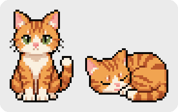

# dsh-cat-pet

Анимированный котик-компаньон для веб-интерфейса
[DeepSeek Harness](https://github.com/deepseek-ai/deepseek-harness).



Кошка живёт поверх интерфейса: её можно перетаскивать, она помнит позицию и
реагирует на то, чем занят агент — сидит, пока всё спокойно, ложится и
засыпает, пока агент думает, и просыпается, когда ход вернулся или вы
начали печатать.

## Установка

```bash
pnpm install
pnpm build          # сборка в lib/
pnpm install-local  # доставить в профиль DSH
```

Затем **перезапустите DSH**.

## Лицензия

MIT — см. [LICENSE](LICENSE).
